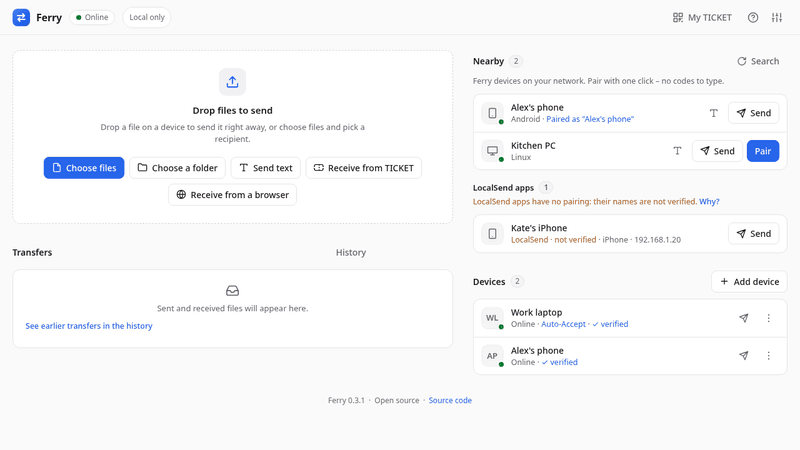
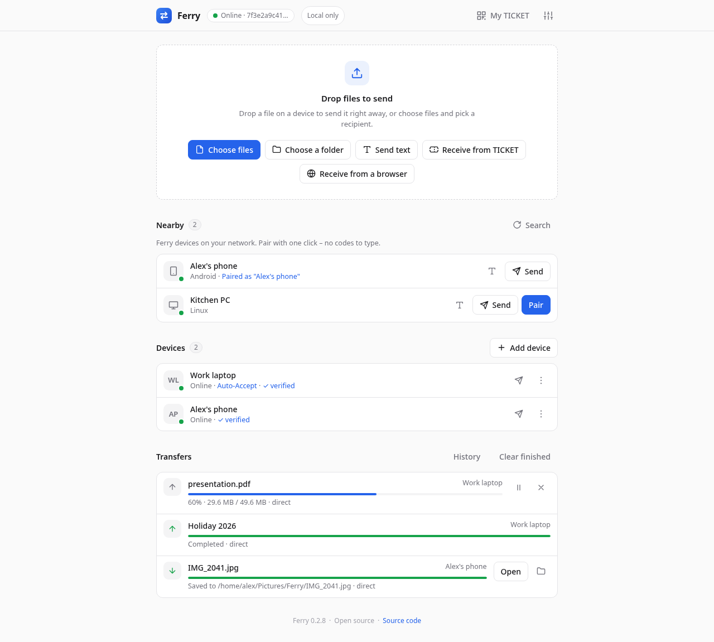
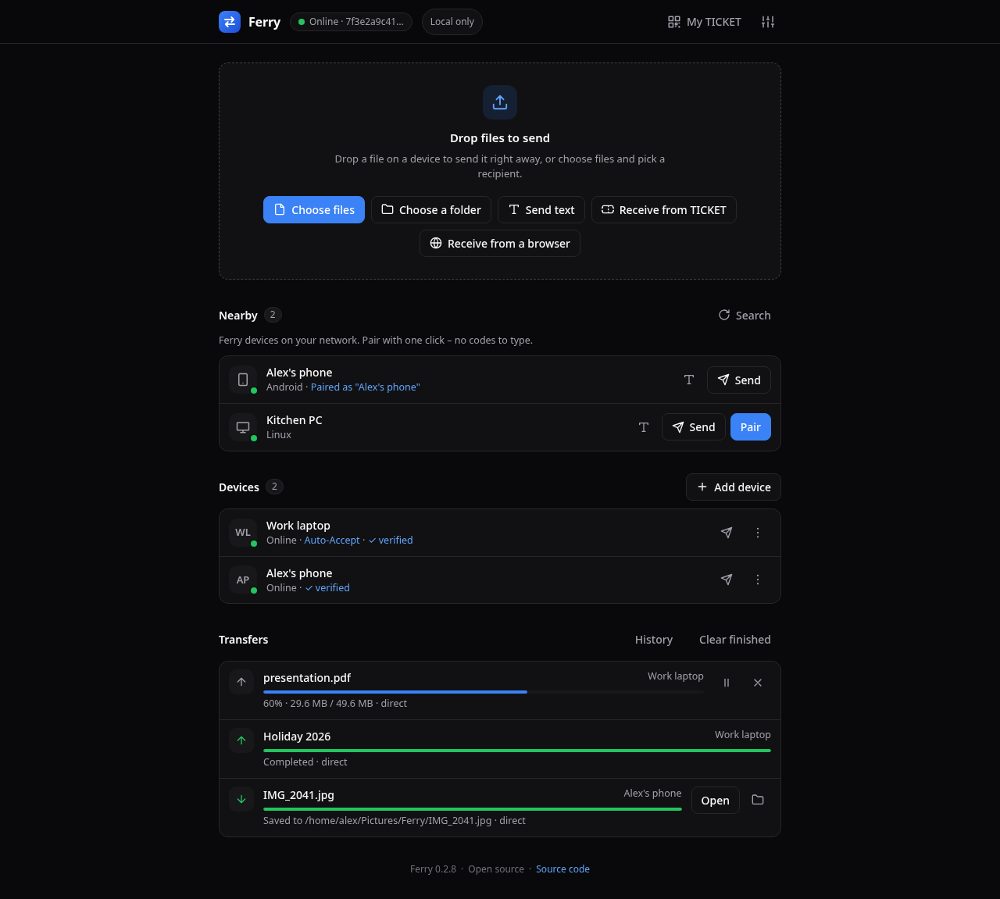
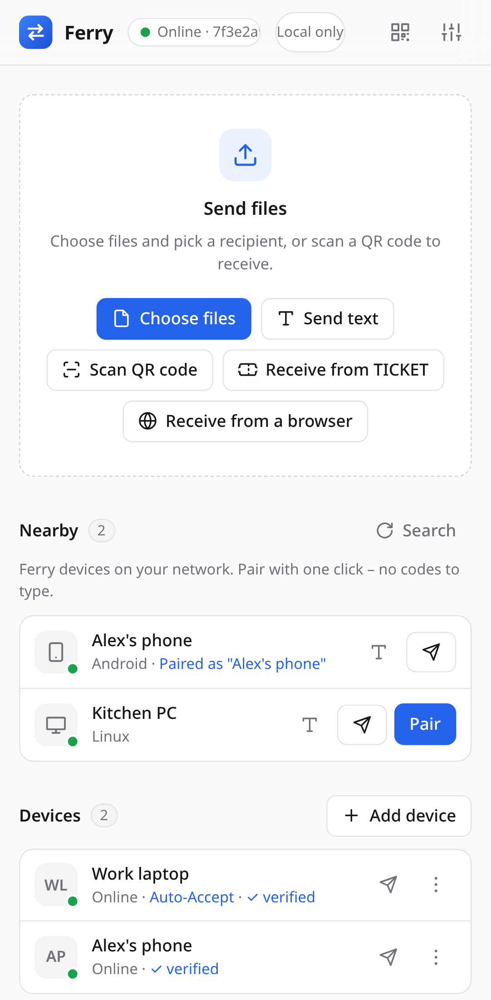
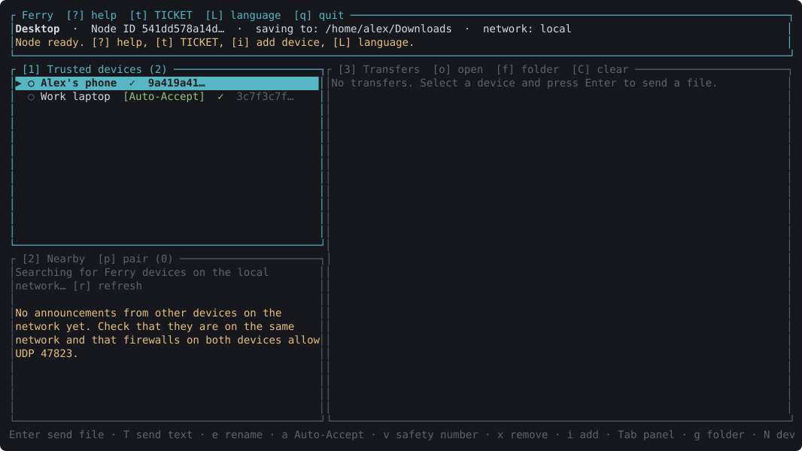
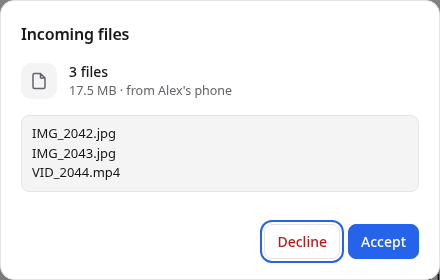

<p align="center"></p>

<h1 align="center">Ferry</h1>

<p align="center"><b>Private, peer-to-peer file sharing for Linux, Windows and Android.</b></p>

<p align="center">
  <a href="https://github.com/VP859/rust-quickshare/actions/workflows/rust.yml"></a>
  <a href="https://github.com/VP859/rust-quickshare/releases"></a>
  <a href="LICENSE-MIT"></a>
  
  
</p>

Ferry sends files, folders and text directly from one device to another over QUIC, end-to-end
encrypted. There is no account, no cloud and no server in between. Devices on the same network
find each other automatically; others connect with a **TICKET** (text or QR code). Optionally,
paired devices can also reach each other from different networks through free public relays – see
[Network modes](#network-modes).

**No telemetry.** Ferry has no analytics, no crash reporting, no update checks and never contacts
its authors. In the default mode it does not contact any server at all.

<p align="center"></p>

| Desktop | Dark theme | Android |
|---|---|---|
|  |  |  |

| Terminal UI (`ferry tui`) | Incoming files |
|---|---|
|  |  |

The images are made from the real interfaces with example data (`tests/gui/screenshots.spec.js`,
`scripts/tui-screenshot.py`).

## Features

- **End-to-end encryption** – QUIC + TLS 1.3 with a persistent Ed25519 key per device (the Node ID).
- **Integrity and resume** – every chunk and the whole file are checked with BLAKE3;
  interrupted transfers resume where they stopped.
- **Files, folders and text** – send several files or whole folders (their structure is kept), or
  a link that lands in the other device's clipboard after confirmation.
- **Nearby devices and one-button pairing** – Ferry devices on the same network appear on their
  own; pairing shows the same six-digit code on both screens.
- **Trusted devices** – an alias and optional Auto-Accept per device; everything else asks first.
- **Photos without location** – optionally, JPEG and PNG photos are sent without where and when
  they were taken and the camera (EXIF, XMP); the picture itself stays exactly the same.
- **Privacy controls** – hide the device from local network discovery except for paired devices,
  and see exactly what leaves the device (*Settings → Privacy*, [details](docs/SECURITY-MODEL.md#what-each-party-can-see)).
- **Cancel any transfer** – a partly received file is resumed next time, or deleted right away
  with *Cancel and delete* (the bin button in the GUI, `X` in the TUI).
- **Pause and speed limit** – pause a transfer and resume it later (the connection stays open), and
  limit the speed of sending and receiving.
- **Several devices at once** – send the same files to several devices in one go.
- **"Send with Ferry" in the file manager** – Dolphin, Nautilus and Nemo on Linux, *Send to* in
  Windows File Explorer ([below](#send-with-ferry-from-the-file-manager)).
- **History** – a searchable list of finished files and texts, kept only on this device (texts
  without their content); it can be cleared or turned off. A file from it can be sent again to the
  same device or to another one (`ferry history --send-again N`). The transfers list shows the
  current session and leads to it.
- **Help where it is needed** – the **?** button in the desktop and Android app answers the usual
  questions in a few sentences each, with links to the documentation; a short welcome card shows
  new users the three steps and goes away for good once closed or once the first device is paired.
- **Accessible** – every control works with the keyboard and has a name for screen readers, and
  text keeps WCAG AA contrast in the light and the dark theme; automated tests check it.
- **Every interface** – desktop and Android app (Tauri), terminal UI, command line and a
  background daemon; English and Polish.
- **iPhone and Mac through LocalSend** – send files and folders to the
  [LocalSend](https://localsend.org) app (iOS, macOS, Android, Windows, Linux), and with an optional
  compatibility mode receive from it ([below](#localsend-compatibility-mode)).

## Install

Ferry has no published release yet. When there is one, the
[releases page](https://github.com/VP859/rust-quickshare/releases) has these files, with
`SHA256SUMS.txt` to check them (`sha256sum -c SHA256SUMS.txt --ignore-missing`):

| Platform | File | Contains |
|---|---|---|
| Debian, Ubuntu | `.deb` | desktop app, `ferry` CLI, systemd user service, "Send with Ferry" for the file managers |
| Fedora, openSUSE | `.rpm` | the same |
| Other Linux | `.AppImage` | desktop app (run `ferry integrate` for the file-manager entries) |
| Windows 10/11 | `-setup.exe` (NSIS) or `.msi` | desktop app; the `.exe` also adds *Send to → Ferry* |
| Android 7+ | `.apk` | the app |
| Command line only | `ferry-cli-*.tar.xz` / `.zip`, or the shell / PowerShell installer | `ferry` |

Until then, build it from source ([docs/BUILDING.md](docs/BUILDING.md) lists the requirements):

```bash
cargo install --path cli --locked              # the `ferry` command line tool
cd src-tauri && npx @tauri-apps/cli@2 build    # desktop app (.deb/.rpm/.AppImage, .msi/.exe)
```

## Quick start

```bash
ferry guide                             # the first steps and the usual questions, briefly
ferry discover                          # devices on the local network
ferry pair "Laptop"                     # the other device confirms; both show the same code
ferry send photo.jpg Holiday/ --to Laptop   # files and folders
ferry text "https://example.org" --to Laptop
ferry daemon                            # receive in the background
ferry tui                               # terminal user interface
```

More commands:

```bash
ferry ticket                            # this device's TICKET and QR code
ferry peer add <TICKET> --alias Laptop --auto-accept
ferry peer verify Laptop             # safety number to compare with the other device
ferry peer list | ferry peer edit Laptop --auto-accept false | ferry peer remove Laptop
ferry send film.mkv                     # share one file through a one-time TICKET
ferry send photos/ --to Laptop --to Phone  # several devices at once
ferry history holiday                   # finished transfers, searched; --clear deletes them
ferry web photo.jpg                     # link + QR code for a browser: download it, send files back
ferry receive <TICKET> ~/Downloads      # download a shared file
ferry config                            # all settings (also: get, set, unset, path)
ferry config set hidden true            # hide this device from unpaired devices
ferry identity export ~/ferry-key.txt   # back up the device key (keep it secret)
ferry doctor                            # network and discovery diagnostics
```

### Settings

| Setting | `ferry config set …` | Default |
|---------|----------------------|---------|
| Device name | `device-name "My laptop"` | host name |
| Language | `language pl` | English |
| Network mode | `network-mode internet` | `local` |
| Download folder | `download-dir ~/Inbox` | system Downloads folder |
| Hidden from unpaired devices | `hidden true` | `false` |
| Send photos (JPEG, PNG) without location and other metadata | `strip-metadata true` | `false` |
| Show the operating system on the local network (it picks an icon) | `announce-platform true` | `false` |
| Random port for direct connections instead of 47824 (after a restart) | `random-port true` | `false` |
| Only paired devices (unknown ones cannot even ask; `ferry pairing` opens pairing for a few minutes) | `paired-only true` | `false` |
| Auto-accept programs and scripts from Auto-Accept devices | `auto-accept-executables true` | `false` (they ask) |
| Copy texts from Auto-Accept devices without asking | `auto-accept-texts true` | `false` |
| Desktop app quits when its window is closed | `quit-on-close true` | `false` (keeps running in the tray) |
| Receive from LocalSend apps (iPhone, Mac) | `localsend true` | `false` |
| Speed limit (per second, sending and receiving separately) | `speed-limit 2M` | `off` |
| Keep a history of transfers | `history false` | `true` |
| Device key in the system keyring (KWallet, GNOME Keyring, Windows Credential Manager) | `ferry identity storage system` | a file (`ferry identity storage file`) |

Settings are stored in `~/.config/ferry/config.toml` (Linux), `%APPDATA%\ferry\config.toml`
(Windows) or the app's private storage (Android). Environment variables:

- `FERRY_CONFIG_DIR` – use another configuration folder (e.g. two devices on one computer),
- `FERRY_LANG` – interface language for this run (`en`, `pl`),
- `RUST_LOG` – log detail (`ferry=debug`).

### Terminal UI (`ferry tui`)

Panels: **[1] Trusted**, **[2] Nearby**, **[3] Transfers** (`Tab` or `1 2 3` to switch, `↑↓` to select).

| Key | Action |
|-----|--------|
| `Enter` / `s` | send a file or folder to the selected device (`Tab` completes paths; drag files into the terminal) |
| `T` | send text or a link |
| `p` | pair with a nearby device |
| `i` / `+` | add a device by TICKET or Node ID |
| `e` / `a` / `x` | rename / toggle Auto-Accept / remove a device |
| `x` (transfers panel) | cancel the selected transfer |
| `o` / `f` / `C` | open the received file / its folder / clear finished transfers |
| `t` / `c` | show / copy this device's TICKET |
| `g` / `N` / `L` | download folder / device name / language |
| `M` / `H` | network mode / hidden mode |
| `y` / `n` | answer an offer or pairing request |
| `?` | help |

### Running in the background

| System | File | Setup |
|--------|------|-------|
| Linux | `dist/systemd/ferry-daemon.service` (installed by the .deb/.rpm packages) | `systemctl --user enable --now ferry-daemon` – runs sandboxed; see the file for cargo installs |
| Windows | `dist/windows/install-autostart.ps1` | Task Scheduler task at logon |

A daemon without a terminal accepts files **only** from devices with Auto-Accept. The desktop app
has its own *Start at login* switch; its tray menu can also send the clipboard (*Send the
clipboard…* opens the text, ready for a device). Closing its window keeps it running in the system tray, or
quits it if you choose so in *Settings → Receiving*; starting Ferry again always brings back the
running window instead of opening a second one.

## Network modes

| | `local` (default) | `internet` | `relay` (own relay) |
|---|---|---|---|
| Servers contacted | none | public iroh relays and DNS run by n0, free of charge | only the relays you set |
| Devices reachable | on the same network (or VPN) | also on other networks (mobile data, another home) | also on other networks, through your relay |
| Finding paired devices | local network | local network, then n0 DNS by Node ID | local network, then the address saved at pairing |
| Encryption | end-to-end | end-to-end; relays forward only encrypted packets | end-to-end; your relay forwards only encrypted packets |
| Visible to servers | nothing | IP addresses, Node IDs and timing – never content | the same, but only to your relay |

Every mode tries a direct connection first; a relay is only the fallback when the devices cannot
reach each other directly. Change the mode with `ferry network local|internet`,
`ferry network relay https://relay.example.org`, `M` in the TUI or *Settings → Network*; it applies
after a restart. The desktop app always shows the active mode in the top bar.

### Own relay

The `relay` mode is the internet mode without n0. It needs an
[iroh relay](https://github.com/n0-computer/iroh/tree/main/iroh-relay) that both devices can reach,
for example on a small VPS or a home server with a forwarded port. Use the version of iroh-relay
that matches Ferry's iroh (1.4):

```bash
cargo install iroh-relay --version 1.4.1 --features server
iroh-relay --dev          
```

For use over the internet, run it with a configuration file that enables TLS (Let's Encrypt or your
own certificate) and give Ferry the `https://` address. Plain `http://` is accepted only for IP
addresses on this computer or the local network.

- Pair devices **after** both use the relay mode: without n0's lookup, a device is found at the
  address saved when pairing, which then contains the relay URL. Devices paired earlier are still
  found on the local network; pair them again to reach them through the relay.
- Both devices can also use different relays: Ferry reaches the other device through the relay
  named in its address.
- Anyone who knows the relay address can use the relay, unless you restrict it in its
  configuration. Your relay sees what n0's relays would: IP addresses, Node IDs, amounts and
  timing, never content.

## Local network and pairing

- Every device announces itself every 5 s on UDP port **47823** (broadcast and multicast
  `239.255.71.83`, no mDNS); transfers use UDP **47824** (files shared by TICKET use 47825–47834). Announcements are signed with the
  device key.
- **Firewall:** allow UDP 47823–47834 on the local network. With firewalld (Fedora, openSUSE)
  Ferry shows the command:
  `sudo firewall-cmd --permanent --add-port=47823-47834/udp && sudo firewall-cmd --reload`.
  VPNs with a kill switch may block the local network (NordVPN: `nordvpn set lan-discovery on`).
- **Android 17+** needs the *Nearby devices* permission for any local network traffic; Ferry asks
  at startup (Settings → Apps → Ferry → Permissions if it was denied).
- **Pairing** shows a six-digit code on both devices – pair only when they match. The code depends
  on random values from both devices, so an impostor cannot predict it.
- When the device list stays empty, every interface explains why (blocked sending, no network,
  nothing received).

## Send with Ferry from the file manager

Select files or folders, right-click and choose **Send with Ferry**; Ferry opens (or comes to the
front) and asks for the recipient.

- **Linux packages (deb, rpm)** install the entry for Dolphin (KDE), Nemo (Cinnamon) and Nautilus
  (GNOME Files; needs nautilus-python, e.g. `sudo dnf install nautilus-python` or
  `sudo apt install python3-nautilus`).
- **AppImage or `cargo install`:** run `ferry integrate` once; it adds the entries for your user
  (in Nautilus without nautilus-python under *Scripts → Send with Ferry*). `ferry integrate --remove`
  takes them away again.
- **Windows:** the installer adds Ferry to *Send to* in File Explorer (Windows 11: *Show more options*).
- Any other file manager: open the files with `ferry-gui -- FILE…`.

## Browser sessions (no app on the other device)

A phone or computer without Ferry can exchange files with it through any web browser on the same
network: *Receive from a browser* (or *Open in a browser* after choosing files) in the GUI, or
`ferry web [files]`, shows a link and a QR code. The browser can download the shared files and
send files to Ferry; every batch from the browser is asked about before it is saved.

- The link contains a one-time token, works only for the first other device that opens it (trying
  it on the computer itself does not count; the GUI shows who opened it), and stops
  after 30 minutes (`--minutes`) or when the session is stopped.
- It uses plain **HTTP** on TCP port **47835** (browsers do not accept the self-signed
  certificates a local server would need), but the files, their names and the list of shared files
  are **encrypted end to end** with a key that is only in the link after `#` – browsers never send
  that part over the network. Someone listening on the network sees only sizes and timing. Someone
  who can *change* the traffic could change the page and make it give the key away, so use
  sessions on networks you trust. With firewalld, Ferry shows the command that opens the port.
- **The page does not load on the phone?** The phone must be on the same Wi-Fi (not a guest
  network). Android 16 and newer let an app – the browser too – reach devices on the local network
  only with the *Local network* permission (*Settings → Apps → the browser → Permissions*; on some
  versions *Nearby devices*). A VPN on the phone can also keep it off the local network. If the
  router's page (e.g. `http://192.168.1.1`) does not open on the phone either, the phone has no
  access to the local network; if only Ferry's link fails, the router may keep devices apart
  (*client isolation*). The GUI shows these hints under the link.
- The browser encrypts and decrypts files in its memory (it cannot stream them to the disk over
  HTTP): very large files (several GB) may not fit on a phone; use the Ferry app or LocalSend for
  those.

## LocalSend compatibility mode

Ferry has no app for iOS and macOS. With this mode on, iPhones, iPads and Macs – or any device
with the free [LocalSend](https://localsend.org) app – can **send files to Ferry**: Ferry appears in
LocalSend's list of nearby devices like another LocalSend device.

- Turn it on in *Settings → Privacy → Receive from LocalSend apps*, or
  `ferry config set localsend true` (the daemon and the TUI pick it up at their next start).
- It is **off by default** because LocalSend has a weaker security model than Ferry: there is no
  pairing and the sender is not verified – its name can be anything, and anyone on the local network
  can offer files. Ferry therefore **always asks** (never Auto-Accept, a daemon without a terminal
  declines), marks the offer as *LocalSend · not verified* with the sender's IP address, warns about
  programs and scripts, and makes a declined sender wait before it can offer again. The transfer is
  encrypted with TLS, but the sender is not authenticated.
- **Sending to LocalSend apps** works without the mode: in the GUI they are listed under *Nearby*
  (*Search* also looks for them) and in the recipient list, on the command line
  `ferry localsend scan` and `ferry localsend send FILE… --to NAME` (or `--to 192.168.1.20` when
  multicast does not get through). An app that requires a PIN gets it from a dialog, or from
  `--pin` / a prompt on the command line. Searching listens on port 53317 for a few seconds, as
  LocalSend apps answer there; when the compatibility mode runs (in the GUI, the TUI or the daemon),
  its server takes the answers, and a search from the command line then finds fewer apps. The same weakness applies the
  other way round: the **receiver's name is not verified**, anyone on the network can announce
  "Kate's iPhone". Ferry only checks that the app presents the certificate it announced, says so
  before sending, and searching shows your device name to the LocalSend apps on the network.
- It uses port **53317** (TCP for the transfers, UDP multicast `224.0.0.167` for discovery); allow
  both in the firewall: `sudo firewall-cmd --permanent --add-port=53317/tcp --add-port=53317/udp &&
  sudo firewall-cmd --reload`. The LocalSend app itself cannot run on the same computer at the same
  time, as both need the port.
- In hidden mode Ferry does not announce itself to LocalSend devices either; a LocalSend app
  can still reach it by IP address.
- A phone that finds Ferry only after *Refresh* in LocalSend, or cannot send to it, usually lacks
  the *Local network* permission for the LocalSend app (Android 16 and newer, in the app's
  permissions).

## Android

Share any file or link from another app to **Ferry** and pick a recipient. A foreground service
with a notification keeps Ferry reachable in the background. Received files are saved to
`Download/Ferry`; photos and videos go to `Pictures/Ferry` so they appear in the gallery.
Ferry's data is excluded from Android backups – a new phone pairs again.

Android's permission dialog appears on the first start: *Local network* (Android 17 and newer –
without it Ferry cannot find or reach devices nearby), notifications, and on Android 10 and older
storage for Downloads. A search under *Nearby* asks for the local network again while it is
missing, and the camera is asked for only when you scan a QR code. Whatever is still missing is
explained in a card on the main screen; "Not now" keeps a hint under *Nearby*, and once Android no
longer shows its dialog, the button opens the app settings.

## Compared with similar tools

| | Ferry | [LocalSend](https://localsend.org) | [KDE Connect](https://kdeconnect.kde.org) | [Warpinator](https://github.com/linuxmint/warpinator) | [PairDrop](https://pairdrop.net) | [croc](https://github.com/schollz/croc) / [magic-wormhole](https://magic-wormhole.readthedocs.io) |
|---|---|---|---|---|---|---|
| Main purpose | file and text transfer | file and text transfer | phone–computer integration | file transfer | file transfer in the browser | file transfer from the terminal |
| Platforms | Linux, Windows, Android | all, including iOS and macOS | Linux, Windows, macOS, Android, iOS (limited) | Linux (Windows and Android ports) | any browser | any with a terminal |
| Between different networks | optional, through relays | no | no | no | yes, through a server | yes, through a relay |
| Trust | pairing with a code, then trusted devices | none (anyone on the network can offer files) | pairing | group code | room or pairing | one-time code phrase |
| Interfaces | GUI, terminal UI, CLI, daemon | GUI, CLI | GUI and many integrations | GUI | web page | CLI |

The table reflects the other projects as we understand them (2026); they change, so check their
documentation. Ferry can send to and receive from LocalSend apps
([above](#localsend-compatibility-mode)) and exchange files with any browser ([above](#browser-sessions-no-app-on-the-other-device)). KDE Connect does much more
than transfers (notifications, remote input, media control); Ferry only moves files and text.
[docs/COMPARISON.md](docs/COMPARISON.md) goes into more detail, including **where Ferry is worse**
and which tool to choose instead.

## Limitations

- **No iOS or macOS app.** iPhones and Macs exchange files with Ferry through the LocalSend app or
  a browser session, both without pairing and with weaker security than between two Ferry devices.
- **Not audited, and largely written with an AI assistant** (see [below](#how-ferry-is-made)).
  It has many tests, fuzzing and a written security model, but no independent review yet.
- **Metadata is visible.** Who talks to whom, when and how much can be seen on the local network
  and, in internet mode, by the relay operator. Ferry does not offer anonymity.
- **Pairing protects only when the codes are compared.** The [known limitations](docs/SECURITY-MODEL.md#known-limitations)
  list this and the other limits of the security model.
- **The LocalSend mode and browser sessions are weaker by design** (no pairing; browser sessions
  encrypt the files with the key in the link but cannot stop someone who changes the page on the
  way); both are off until used and always ask before saving anything.
- **Background on Android** depends on the phone: battery savers can pause Ferry; the app shows
  what limits it.

## FAQ

**Is my data sent through a server?** Not in the default local mode: devices connect directly.
In internet mode, connections still go directly when possible and otherwise through a relay that
only forwards encrypted packets; you can run your own relay ([Own relay](#own-relay)).

**Why is a device not in the *Nearby* list?** Both devices must be on the same network and the
firewall must allow UDP 47823–47834 ([details](#local-network-and-pairing)). VPNs with a "kill
switch" often block the local network. `ferry doctor` checks the usual causes.

**The browser link does not open on my phone.** Usually the phone's browser may not reach the
local network: on Android 16 and newer allow it *Local network* (or *Nearby devices*) in the app's
permissions. Also check that the phone is on the same Wi-Fi and not behind a VPN, and see
[browser sessions](#browser-sessions-no-app-on-the-other-device). The same permission is needed by
the LocalSend app when it sends to Ferry.

**What happens if a transfer is interrupted?** The partly received file is kept; sending the same
file again continues where it stopped. A broken connection is retried automatically.

**Can someone send me files I did not ask for?** Only devices you trust with Auto-Accept can;
everyone else needs your confirmation, and programs and scripts always ask, even from Auto-Accept
devices.

**How do I move Ferry to a new computer and keep my pairings?** `ferry identity export FILE` on the
old one, `ferry identity import FILE` on the new one. Keep the file secret.

**Where is my data stored?** In `~/.config/ferry` (Linux), `%APPDATA%\ferry` (Windows) or the app's
private storage (Android): the device key (optionally in the system keyring), the configuration and,
unless turned off, the history of transfers. Nothing is stored anywhere else.

## Security

Read [docs/SECURITY-MODEL.md](docs/SECURITY-MODEL.md) for what Ferry protects against and its known
limits, and [SECURITY.md](SECURITY.md) to report a vulnerability privately. Ferry has not been
audited.

## Documentation

- [Compared with other tools](docs/COMPARISON.md) – including where Ferry is worse
- [Benchmarks](docs/BENCHMARKS.md) – measured speeds and how to repeat the measurements
- [Architecture](docs/ARCHITECTURE.md) – how the crates and interfaces fit together
- [Protocol](docs/PROTOCOL.md) – wire format, pairing and discovery
- [Building](docs/BUILDING.md) – desktop, Android, checks and releases
- [Testing](docs/TESTING.md) – tests, fuzzing, bad networks, benchmarks, Android by hand
- [Translating](docs/TRANSLATING.md) – improving or adding a language
- [Contributing](CONTRIBUTING.md) and the [changelog](CHANGELOG.md)

The same documents form the project website (mdBook): `python3 -I scripts/build-site.py` builds it
into `target/site` ([BUILDING.md](docs/BUILDING.md#website)).

## Project

- [Roadmap](ROADMAP.md) – what is planned, and what is not
- [Governance](GOVERNANCE.md) – who decides and how
- [Funding](docs/FUNDING.md) – Ferry receives no money yet; how donations will be handled openly

## How Ferry is made

Ferry is **"vibe-coded"**: most of its code, tests and documentation were written by an AI coding
assistant – Claude, a model made by Anthropic – following the instructions of the author, who
decides what Ferry should do, reviews and tests the results and publishes them. Treat the code
accordingly: read it, test it, and report what you find.
(
<sub>Written with the help of Claude (Anthropic), at the author's request.</sub>

## License

Licensed under either of [Apache License, Version 2.0](LICENSE-APACHE) or
)[MIT license](LICENSE-MIT) at your option. Unless you explicitly state otherwise, any contribution
intentionally submitted for inclusion in Ferry by you, as defined in the Apache-2.0 license, shall
be dual licensed as above, without any additional terms or conditions.
